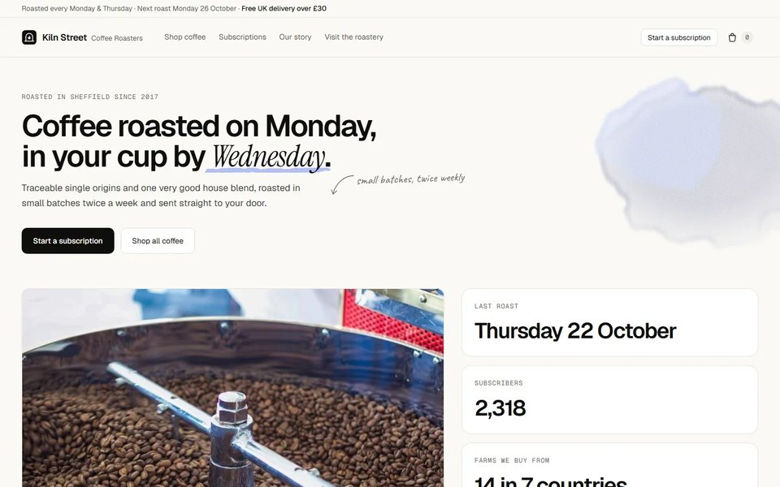
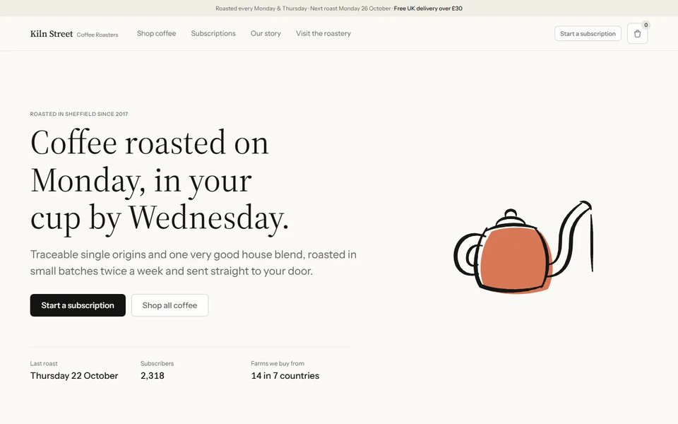
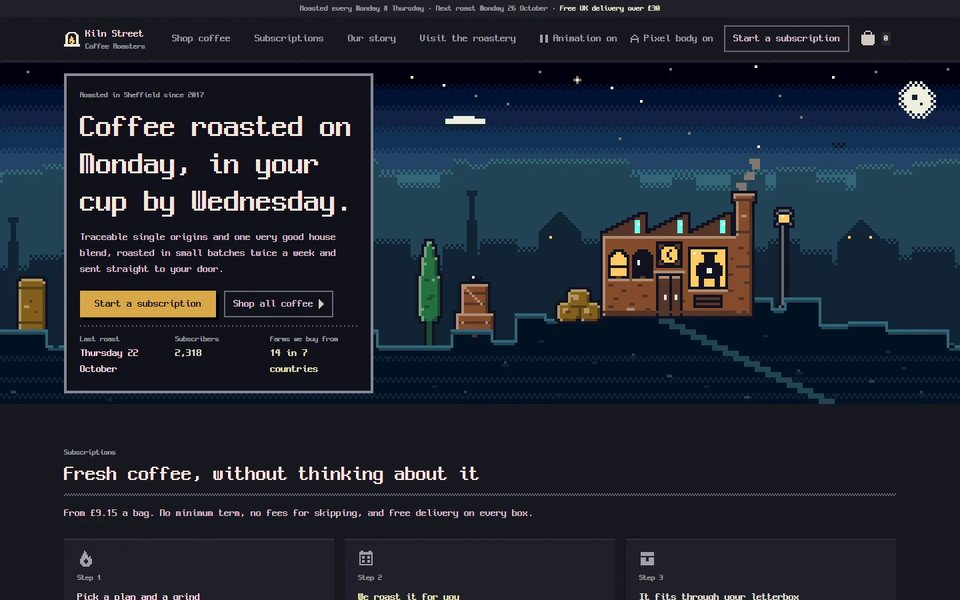
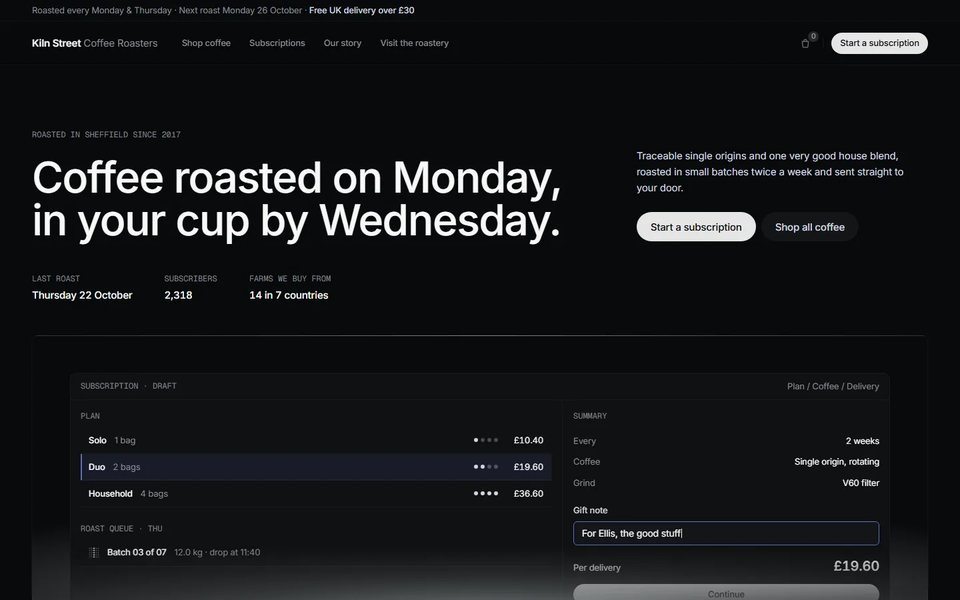
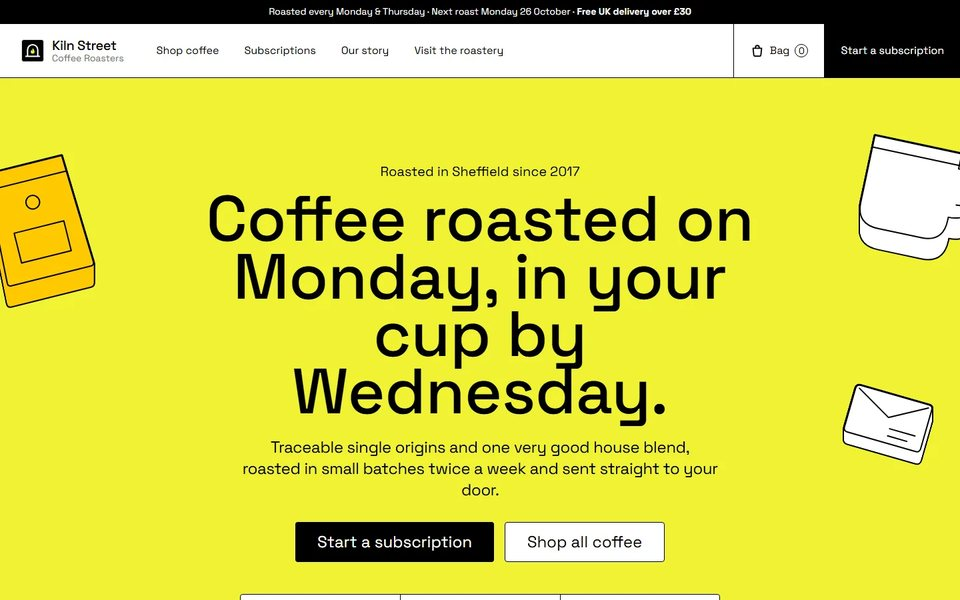
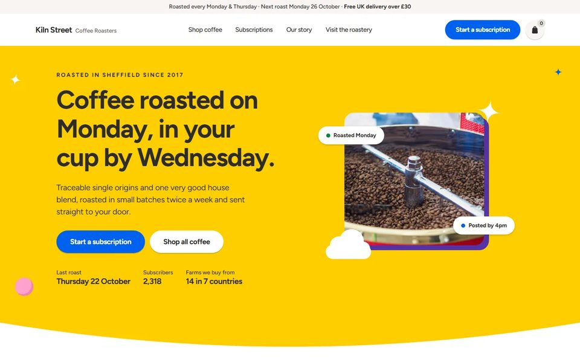

<div align="center">

<a href="https://pigmentui.com"></a>

<h3>Design systems your coding agent can actually follow.</h3>

<p>
  <a href="https://pigmentui.com"></a>
  <a href="https://www.npmjs.com/package/pigment-mcp"></a>
  <a href="https://github.com/mirunamu00/pigment/actions/workflows/ci.yml"></a>
  <a href="LICENSE"></a>
  
</p>

<p>
  <a href="https://pigmentui.com"><b>Browse systems</b></a> ·
  <a href="https://pigmentui.com/connect">Connect an agent</a> ·
  <a href="https://pigmentui.com/docs">Docs</a> ·
  <a href="https://www.npmjs.com/package/pigment-mcp">npm</a>
</p>

</div>

<br />

Coding agents ship working screens that drift apart: every request fills the gaps with the model's own
defaults. **Pigment** gives your agent a complete design system — exact tokens, component
states and decision rules — so every screen it builds, today or next month, looks like it belongs.

## Quick start

**1 · Connect once**

```bash
claude mcp add --transport http pigment https://pigmentui.com/mcp
```

**2 · Ask your agent** — at whichever point your project is

> Set up the Pigment design system morning-shapes in this project. &nbsp;*(starting out)*
>
> Apply the Pigment design system morning-shapes to this project. &nbsp;*(a product that already works)*

That's it. Your agent sets the system up as your project's own design system: it keeps the whole spec in
`design-system/agent.md` with the tokens, and points AGENTS.md and CLAUDE.md at it — so every screen any later
session builds follows it. Updates to the system never restyle your project unless you ask for them.

<details>
<summary><b>Codex, Cursor and other MCP clients</b></summary>

<br />

Remote (nothing to install) — point your client at `https://pigmentui.com/mcp`.

Local, with the specs bundled in the package:

```json
{
  "mcpServers": {
    "pigment": { "command": "npx", "args": ["-y", "pigment-mcp"] }
  }
}
```

</details>

<details>
<summary><b>No MCP?</b></summary>

<br />

Every system page on [pigmentui.com](https://pigmentui.com) has a ready-made prompt to copy into any
agent and a plain spec URL (`/s/<id>/agent.md`) — the whole spec in one file, which you can also download
for offline setups.

</details>

## The gallery

Every system is shown on the same three realistic products — a coffee shop, a magazine and a recipe app, each
with its own design and public-domain photos — restyled by a coding agent from the standard prompt. Unedited
output; below, the coffee shop's first screen. Six systems so far:

<table>
  <tr>
    <td width="50%"></td>
    <td width="50%"></td>
  </tr>
  <tr>
    <td width="50%" valign="top"><b><a href="https://pigmentui.com/s/margin-notes">Margin Notes</a></b> — warm paper, near-black ink, hairlines; the only color is a watercolor wash kept to the margins.</td>
    <td width="50%" valign="top"><b><a href="https://pigmentui.com/s/inkleaf">Inkleaf</a></b> — warm ink on cream paper, a text serif, hand-drawn ink pictograms and pastel stages that hold product UI.</td>
  </tr>
  <tr>
    <td width="50%"></td>
    <td width="50%"></td>
  </tr>
  <tr>
    <td width="50%" valign="top"><b><a href="https://pigmentui.com/s/night-cartridge">Night Cartridge</a></b> — a 16-bit console booted as a product: night-blue ground, pixel type, small scenes that move in stepped frames. Dark only.</td>
    <td width="50%" valign="top"><b><a href="https://pigmentui.com/s/graphite-blueprint">Graphite Blueprint</a></b> — a near-black instrument panel: graphite greys, hairlines, one indigo, real UI on spotlit stages.</td>
  </tr>
  <tr>
    <td width="50%"></td>
    <td width="50%"></td>
  </tr>
  <tr>
    <td width="50%" valign="top"><b><a href="https://pigmentui.com/s/felt-tip-market">Felt-tip Market</a></b> — a cheerful storefront in black felt-tip: ink hairlines, flat poster-color bands, chunky sticker objects.</td>
    <td width="50%" valign="top"><b><a href="https://pigmentui.com/s/morning-shapes">Morning Shapes</a></b> — sunny and toy-like: cream pages, flat color fields with arched edges, crescent-shaded shapes and chunky pills.</td>
  </tr>
</table>

On [pigmentui.com](https://pigmentui.com) every system shows every page of all three products, before and after,
desktop and mobile, light and dark.

## Why it works

| Principle | What it means |
| --- | --- |
| **Measured, not adjectival** | Every rule carries a value: color, type, spacing, radius, elevation and motion — light and dark. |
| **Rules, not page templates** | Decision rules for any product. A system is tested on four demo apps but never written for them: a lint flags rules that name a demo app's screens, data or copy. |
| **Proven before publishing** | Every system — and every update — is applied by an agent to four test apps, three times each, then to two more of a different shape (a landing page and a docs site) that never steer the design. The apps must build and pass their tests, and a review scores how close the results come to the reference's design quality before anything is published. |
| **Shown on real products** | What you see of a system is an agent applying it to three realistic products — a shop, a magazine and an app with their own design and photos — every page, before and after, unedited. |
| **Yours to keep** | Your project keeps its own copy. Updates come with a dated changelog and land only when you ask. |

## What your agent gets

| You get | What it is |
| --- | --- |
| `agent.md` | One document: character, defining rules, tokens, components, how to apply |
| `tokens.css` · `tokens.json` | Exact values, light and dark — copied, never retyped |
| MCP tools | `list_design_systems` · `get_design_system` · `get_tokens` · `get_component_spec` · `get_installation_guide` · `get_changelog` · `get_references` |
| HTTP API | [`/api/v1/design-systems`](https://pigmentui.com/api/v1/design-systems) — the same specs as JSON |

## How systems are made

Templates aren't drawn by hand. A reference site goes through a reproducible pipeline, with a person
approving the analysis and the final result:

```
reference ─▶ capture & measure ─▶ analysis ─▶ design prompt ─▶ validate
          ─▶ agent applies it to 4 test apps ─▶ evaluate ─▶ review ─▶ iterate ─▶ publish ─▶ showcase
                   screen on one sample, confirm on three plus two holdout apps
```

The review scores how close the agents' results come to the reference's design quality (0–5 per area) and lists
the gaps; broken details count only when the prompt caused them. Revisions are written from a generated brief as
general principles — the author never reads the test apps, and the showcase products never steer a system.

Systems are **derived design languages, never clones** — no logos, names, copy, imagery or proprietary
fonts carry over. Details in [`docs/harness/`](docs/harness/README.md).

<details>
<summary><b>Development</b></summary>

<br />

Requires Node 22+ and pnpm.

```bash
pnpm install
npx playwright install chromium   # once: capture, screenshots, e2e tests
pnpm dev                          # http://localhost:3000
```

```bash
pnpm typecheck
pnpm test             # harness, content, MCP server, site e2e
pnpm check:content    # systems valid, published versions untouched
```

Adding a system: `pnpm harness --help`, or the `template-intake` skill in Claude Code, which runs the
whole pipeline and stops for approval after the analysis and before publishing.

| Path | What |
| --- | --- |
| `apps/web` | The site: gallery, docs, `/api/v1`, `/mcp`, the `agent.md` spec URLs |
| `packages/mcp` | MCP server — the site's `/mcp` route and the `pigment-mcp` npm package |
| `packages/harness` | `pnpm harness` — capture → prompt → demo runs → evaluation → publish → showcase |
| `packages/content` · `packages/schema` | Read-only content access and the data contracts |
| `content/templates` | The systems themselves |
| `showcase/base-apps` | The four neutral apps every system is tested on, and two holdout apps (landing, docs) used only to confirm — the test, never shown |
| `showcase/products` | Three realistic products every published system is applied to; what the site shows (`pnpm harness showcase`) |

| Variable | Default | |
| --- | --- | --- |
| `NEXT_PUBLIC_SITE_URL` | `https://pigmentui.com` | prompts, spec links |
| `NEXT_PUBLIC_MCP_URL` | `<site>/mcp` | connect snippets |
| `PIGMENT_CONTENT_DIR` | `<repo>/content` | site, API and MCP server |
| `PIGMENT_WORKDIR` | `<os tmp>/pigment-runs` | where agents restyle base-app copies |

Changes reach `main` only through pull requests with a green CI — see [`CONTRIBUTING.md`](CONTRIBUTING.md).
Merging deploys the site (Vercel) and publishes a new `pigment-mcp` version when
`packages/mcp/package.json` changes, via npm trusted publishing. See [`docs/deploy.md`](docs/deploy.md).

</details>

## Contributing

Bug reports, feedback on how agents apply a system, and suggestions for new systems are welcome as
[issues](https://github.com/mirunamu00/pigment/issues/new/choose). Code changes go through pull requests —
see [`CONTRIBUTING.md`](CONTRIBUTING.md), the [code of conduct](CODE_OF_CONDUCT.md) and the
[security policy](SECURITY.md).

## License

[MIT](LICENSE) © 2026 [mirunamu00](https://github.com/mirunamu00)
